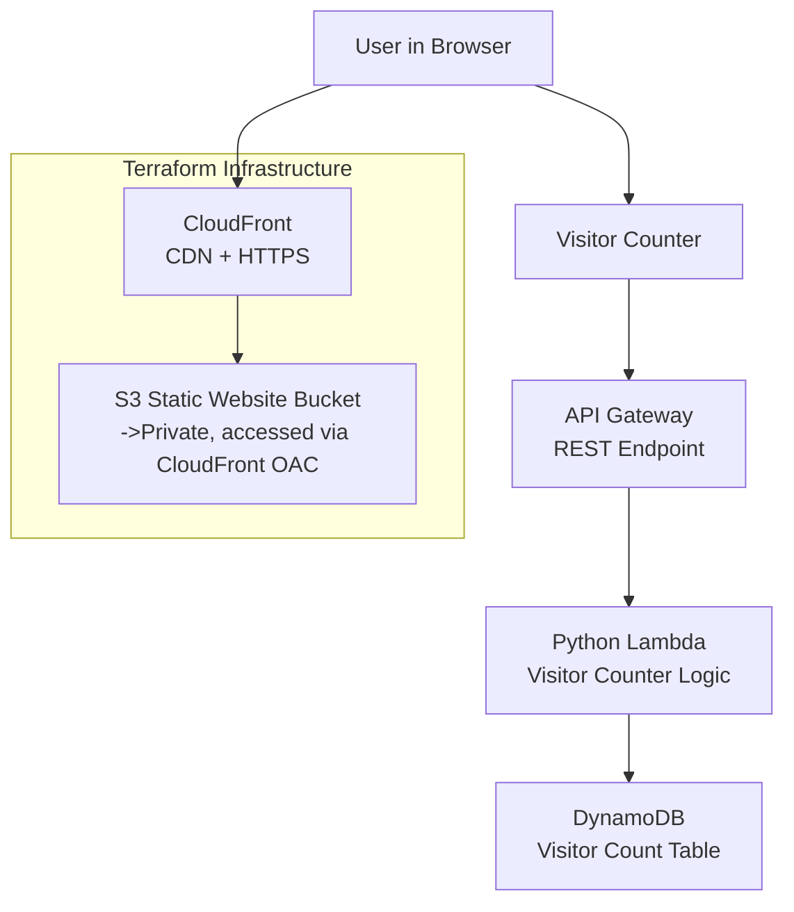

# 🌥️ Cloud Resume Challenge — Full Project

This project is my completed version of the **Cloud Resume Challenge**, following best practices for **AWS, Serverless, IaC, CI/CD, and frontend development**.

It showcases my ability to build a **fully deployed, cloud-native, production-style application**, integrating:

* **S3** (static website hosting)
* **CloudFront** (global CDN + HTTPS)
* **Route 53** (DNS + custom domain)
* **API Gateway**
* **Lambda (Python)**
* **DynamoDB** (visitor counter)
* **Terraform** (for S3 + CloudFront infrastructure)
* **GitHub Actions (OIDC)**

---

# 🌐 Live Demo

➡️ **[https://resume.helipatel.com](https://resume.helipatel.com/#home)**

---

# 📌 Project Summary

This project consists of:

### ⭐ **Frontend**

A static HTML/CSS/JS resume website hosted on S3 and served globally through CloudFront.

### ⭐ **Backend**

A serverless Python Lambda function connected to DynamoDB through API Gateway to track visitor count.

### ⭐ **Infrastructure as Code (IaC)**

Terraform is used to provision the **S3 static site**, **CloudFront distribution**, and related infrastructure.

### ⭐ **CI/CD**

A GitHub Actions workflow automatically uploads the frontend to S3 on every push to `main`.

---

# 🏗️ Architecture Diagram



---

# 🧰 Technologies Used

| Layer             | Technologies                  |
| ----------------- | ----------------------------- |
| **Frontend**      | HTML, CSS, JavaScript         |
| **Backend**       | AWS Lambda (Python), DynamoDB |
| **API Layer**     | API Gateway                   |
| **Hosting & CDN** | S3, CloudFront, Route 53      |
| **IaC**           | Terraform (S3 + CloudFront)   |
| **CI/CD**         | GitHub Actions (OIDC)         |

---

# 📁 Project Structure

```
cloud-resume-challenge/
│
├── .github/
│   └── workflows/
│       └── front-end-cicd.yml      # GitHub Actions workflow to deploy Website/ to S3
│
├── Infra/                          # Terraform for S3 + CloudFront
│   ├── main.tf                     
│   ├── provider.tf                 
│   ├── cloudfront.tf               
│   ├── s3.tf                       
│   ├── s3_policy.json              
│   ├── .terraform.lock.hcl
│   └── .gitignore
│
├── Website/                        
│   ├── index.html
│   ├── index.js
│   ├── assets/
│   └── .DS_Store                   
│
└── README.md
```

---

# ⚙️ How the System Works

### 1️⃣ **User loads the resume website**

* CloudFront retrieves content from S3
* HTTPS enabled via ACM
* Route 53 points the domain to CloudFront

### 2️⃣ **Visitor count is requested**

* `index.js` calls the API Gateway endpoint

### 3️⃣ **API Gateway triggers Lambda**

* Lambda reads/writes visitor count from DynamoDB

### 4️⃣ **Response returned to user**

* Updated visitor count is displayed on the site

---

# 🚀 CI/CD Pipeline (Frontend)

Workflow:
`.github/workflows/front-end-cicd.yml`

### 🔄 What it Does

* Triggers on every push to `main`
* Uses GitHub OIDC → IAM role (no AWS keys stored)
* Deploys files from `/Website` to S3
* Invalidates CloudFront cache

### ❗ What it Does *Not* Do

* It does not deploy Lambda or backend code
* Backend updates are currently handled manually or separately

---

# 🧪 Backend (Lambda + DynamoDB)

### Visitor Counter Behavior

* Uses DynamoDB `update_item` for atomic increments
* Lambda handles:

  * retrieving current count
  * incrementing count
  * returning updated count
* IAM policies ensure least privilege access

---

# 🏗️ Deploying Infrastructure (Terraform)

```sh
cd Infra
terraform init
terraform validate
terraform plan
terraform apply -auto-approve
```

---

# 🧠 Key Concepts to Understand (Interview Prep)

### AWS

* S3 static hosting
* CloudFront CDN + caching
* OAC (Origin Access Control)
* Lambda execution roles
* DynamoDB design basics

### Serverless

* API Gateway → Lambda integration
* CORS
* JSON responses

### IaC

* Terraform state management
* Resource configuration & outputs
* CloudFront + S3 integration

### CI/CD

* GitHub Actions workflow triggers
* OIDC trust relationships
* Deploying artifacts to S3

---

# 🛠️ Future Improvements

* Add backend CI/CD for Lambda
* Add Terraform modules for DynamoDB + API Gateway + Lambda
* Add CloudWatch dashboards
* Add unit tests for Lambda
* Add blue/green deployment for frontend

---

# 📌 Conclusion

This project demonstrates practical experience with:

▶ AWS serverless architecture
▶ Terraform for cloud infrastructure
▶ CloudFront + S3 static hosting
▶ DynamoDB + Lambda backend
▶ CI/CD automation with GitHub Actions

A complete, real-world cloud project showcasing both **DevOps** and **cloud engineering** skills.

