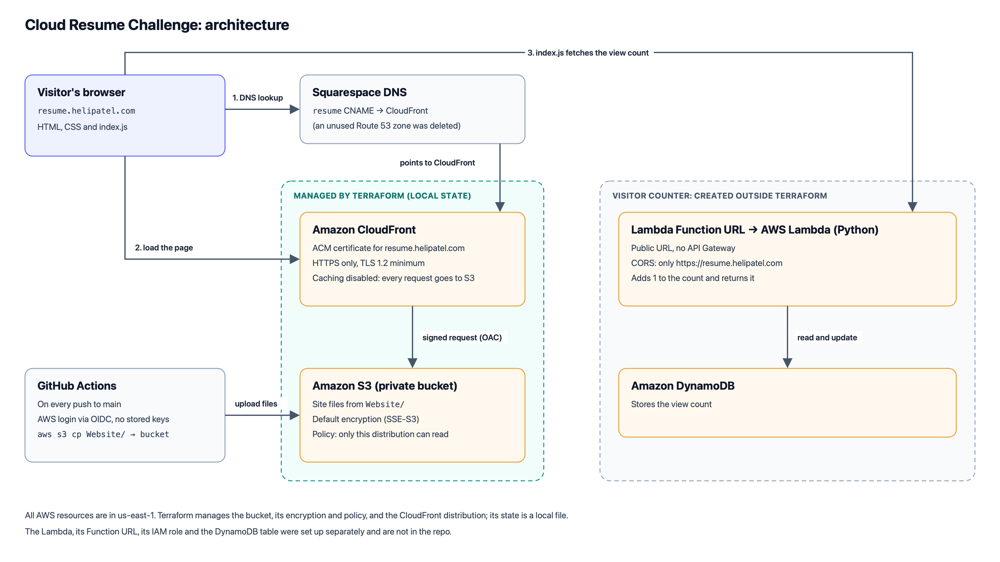

# Cloud Resume Challenge

My resume as a static website on AWS, with a visitor counter. Live at **[resume.helipatel.com](https://resume.helipatel.com/)**.

> **Status:** an early project, built January to March 2025. Write-up: [helipatel.com/projects/cloud-resume-challenge](https://helipatel.com/projects/cloud-resume-challenge/).



## How it works

- **Hosting:** HTML, CSS and JavaScript in a private S3 bucket, served through CloudFront. The bucket policy only allows reads from this CloudFront distribution (Origin Access Control). Files are encrypted at rest (SSE-S3).
- **HTTPS:** an ACM certificate for `resume.helipatel.com` on CloudFront, HTTPS only, TLS 1.2 minimum.
- **DNS:** `resume.helipatel.com` is a CNAME to the CloudFront distribution (DNS is hosted at Squarespace).
- **Visitor counter:** `Website/index.js` calls a Lambda Function URL, which updates a count in DynamoDB and returns it.
- **Deploy:** on every push to `main`, GitHub Actions logs into AWS with OIDC and copies `Website/` to the bucket.

## Repo layout

| Path | What |
|---|---|
| `Website/` | The site: `index.html`, `index.js` (counter), `assets/` |
| `Infra/` | Terraform for the S3 bucket, its encryption and policy, and CloudFront |
| `.github/workflows/front-end-cicd.yml` | Deploy to S3 on push to `main` |

## What's in Terraform, and what isn't

Terraform manages the bucket, its encryption, its policy and the CloudFront distribution. The visitor counter (the Lambda, its Function URL, its IAM role and the DynamoDB table) was set up by hand in the AWS console. `Infra/main.tf` has a commented-out start on it. Terraform state is local and not committed.

## Deploying the infrastructure

```sh
cd Infra
terraform init
terraform validate
terraform plan
terraform apply
```

## Deploy settings

The workflow needs two repository secrets:

- `AWS_ROLE_TO_ASSUME`: the IAM role GitHub Actions assumes through OIDC
- `AWS_S3_BUCKET`: the bucket name

## What I'd improve

- Bring the counter into Terraform.
- Use remote Terraform state (S3 backend with locking).
- Add a test for the Lambda and a smoke test after each deploy.
